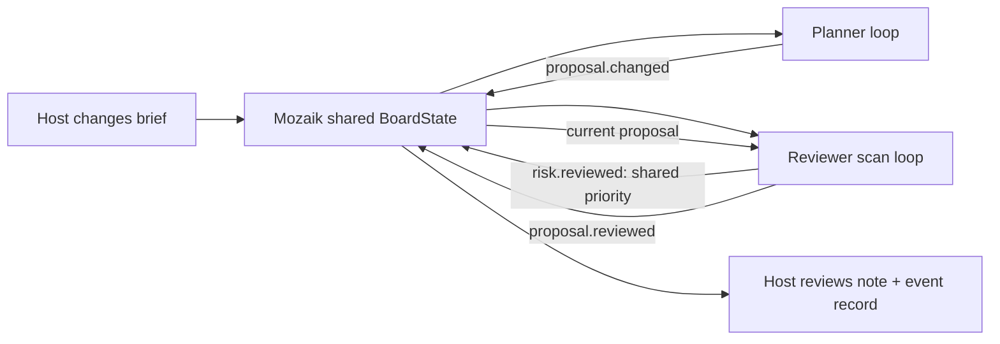

# Ponto Comum — a shared plan, with room for a change

A small local planning desk for a fictional community workshop. Two Mozaik agents work concurrently on one board: a Planner proposes a venue, activity and refreshments; a Feasibility Reviewer scans the brief in parallel, shares a priority and reviews the exact proposal. A change of budget, weather or venue invalidates old answers.

Built during the 30–31 October 2026 JigJoy hackathon, **Freestyle** track. Bruno Fernandes participates solo. Development, implementation and documentation were assisted by Codex. This is a prototype using an authored fictional catalog, not a validated service or real venue directory.

## Try it

The GitHub Pages demonstration is a **read-only recording of a real local run**, clearly labelled on screen. It makes no live model calls. Clone and run the project for the editable planning room.

### Windows x64, Node.js 22+

```powershell
npm ci
npm run setup:model
npm run model
```

Keep that terminal open. In a second terminal in the same folder:

```powershell
npm start
```

Open http://127.0.0.1:4351/. Click **Start a planning round**, then **Try a change: rain + smaller budget**. The change also works while the two agents are still thinking. Review the exact prices and constraints above the generated notes. Download the planning note or complete run record. Nothing is booked, paid, or sent to an attendee.

The setup helper downloads about 664 MB once, from official llama.cpp and Qwen release locations. It checks both published SHA-256 digests before extracting or running the model server. Files stay in ignored `.runtime/`. No account, API key or paid service is required. The model is Qwen3-0.6B-Q8_0, revision `23749fefcc72300e3a2ad315e1317431b06b590a`; the CPU server is llama.cpp `b11960`, configured with two parallel decoding slots and 4 CPU threads. Inference speed depends on the machine.

On other systems, install an official llama.cpp server, download that same model revision, and serve it on loopback port 4350 with alias `ponto-comum-local`, two slots and at least 4096 context tokens per slot. The automated download/extraction helper is Windows-only; other operating systems have not been tested.

## What the two agents actually do

- **Planner:** uses a live local language-model call to select an offered catalog combination and explain its tradeoff. Unknown or unoffered IDs are rejected. The model does not create prices.
- **Feasibility Reviewer:** starts scanning the brief while the Planner is already thinking. It contributes a bounded planning priority to shared state, causing the Planner to reconsider its proposal. It then performs a separate live model review of the exact proposal and code-generated constraint checks.
- **Host:** edits the brief and remains responsible for the final real-world decision.

Both agents are actual `createAgent` participants. Their situation handlers call Mozaik `runLoop`; a custom `InferenceRunner` maps each loop to the local llama.cpp HTTP endpoint and returns Mozaik `ModelMessageItem` outputs. This is not a scripted agent animation or a sequence of predetermined model answers.



The initial broadcast starts both agents independently. A busy agent coalesces subsequent events instead of spawning unlimited turns. There are at most four turns per role per revision. Responses carry revision and peer-review versions; a changed brief or superseded proposal discards the old response and schedules current work. The agents coordinate through the actual `RuntimeState` subclass and custom Mozaik events, not separate disconnected summaries.

## What code verifies, and what remains a model judgment

Code enumerates feasible catalog combinations, calculates all costs in integer cents, rounds a fixed 10% contingency up, and verifies budget, attendance, capacity, step-free access, rain shelter and closures. A computed tight/adequate budget band restricts the reviewer's allowed priorities. The model chooses within that bounded space and supplies explanatory notes and a review verdict. This deliberately keeps arithmetic and hard policy out of the language model.

Generated explanations are **not independently verified facts**. They may describe a constraint incorrectly or overstate a tradeoff. The UI labels them accordingly and displays authoritative catalog calculations separately. A result is ready for **host review**, not a booking or a guarantee of real-world feasibility. It is not an optimality claim.

## Reproduce the recorded checks

With the model server running:

```powershell
npm run demo
node demo.mjs --midflight
```

The first command runs the original brief, waits for the two perspectives to settle, then applies rain, a closed garden and a reduced budget. The second changes the brief after 500 ms, while inference is in flight. Both write complete timestamped local-run receipts in `evidence/` and fail if no successful live calls overlap, if the final plan fails hard checks, or if the final review is not ready for host review.

- `evidence/live-run.json`: current implementation, ten real model calls, four overlapping cross-agent call pairs, two old answers discarded; final `V2-A3-F3`, total 46,200 cents including 4,200 reserve, against a 48,000-cent budget. These are counts for one authored local scenario, not accuracy statistics.
- `evidence/live-browser-run.json`: current live application exercised through the browser, including a brief change while both agents were thinking; seven real model calls, four overlapping pairs, three stale answers discarded and a feasible reviewed result. The downloaded JSON and planning note were read back and checked.
- `evidence/live-midflight.json`: a real change-during-inference run. The first recorded version predates the budget-band guard. It demonstrates revision invalidation; check the `VERIFICATION.md` record for the version tested.
- `evidence/live-run-before-budget-band.json`: deliberately retained initial run in which the small reviewer incorrectly called an 80,000-cent budget below 60,000. It motivated the explicit band and allowed-priority checks. This error is not hidden or counted as a correctness success.

The timestamps are emitted by Mozaik `inference.started` and `inference.completed` events. Each network result includes a request ID, actual provider usage when reported, model name, and SHA-256 request/response fingerprints. The public record contains synthetic data only. Overlap means real model-call intervals overlap; it does not measure speedup or prove every sentence correct. The local server also used two decoding slots.

```powershell
npm test
```

Ten meaningful tests cover integer arithmetic, reserve rounding, every offered option's feasibility across varied briefs, invalid input, unoffered model IDs, infeasible briefs, cross-revision races, invalid model responses, offline provider handling and honest overlap metrics. Their controlled runner outputs are labelled `live:false` and **never count as real model inference**.

## Privacy, boundaries and limitations

- Only the authored fictional catalog is used. There are no real attendees or personal records.
- Inference goes to loopback only. No hosted model, account or paid API is used. First-time public downloads need internet access.
- Mozaik cloud telemetry is explicitly disabled in this process; cached pairing credentials from other projects are not used.
- The HTTP application listens on `127.0.0.1`, restricts host/origin, serves a file allowlist and accepts bounded JSON requests. It is a local prototype, not a public multi-user server.
- The board is held in memory; restarting the application loses it. Export a run record if needed. Downloaded files and backups must be managed by the person who saves them.
- There is no invented model fallback. Provider failures and invalid outputs become visible errors. A recorded demonstration never replaces a live request.
- This small model can make reasoning mistakes. Real availability, costs, accessibility requirements and arrangements need human confirmation. No user testing or production reliability has been claimed.
- Browser follow-up on 30 October verified the published recording at desktop and a 375 CSS-pixel mobile viewport, both download files, and a live interactive change-during-inference run. This is one browser and viewport check, not universal device compatibility testing.

## Project files

`runtime.mjs` contains the Mozaik participants and local inference adapter; `domain.mjs` holds the fictional catalog and hard constraints; `server.mjs` serves the local application; `public/` contains the interface; `tools/` has verified public-model setup, server launcher and static-demo preparation; `evidence/` contains actual run records. The published static demonstration is generated into `docs/`.

## License and credits

Application code and original SVG/CSS illustration: MIT, Bruno Fernandes, 2026. Mozaik 4.1.0 is MIT, by JigJoy. llama.cpp is MIT, by its contributors. Qwen3 model weights are Apache-2.0, by Qwen. `npm ci` uses the pinned lockfile; upstream dependencies keep their own licenses. See `THIRD_PARTY_NOTICES.md`.

Official track: https://build.jigjoy.ai/tracks/freestyle . The updated deadline is 31 October, 20:00 CET (16:00 Brasilia). A public reproducible repository and README are required; the track says no video is needed. The submission is not complete until accepted by the participant portal.

